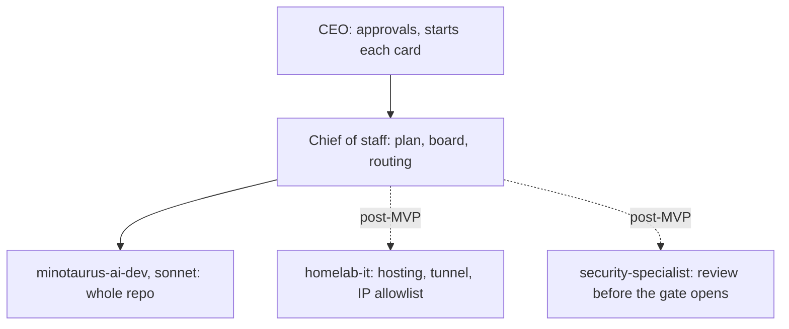

# Team

## Involvement log

| Date | Who | What |
|---|---|---|
| 2026-11-21 | chief of staff | design with EGM (Overview, Technical Plan, Alternatives, Implementation); skeleton; board |
| 2026-11-21 | minotaurus-ai-dev | S1: schemas, easy-01, engine (levels, observe, MazeEnv, Race), `play`, 43 tests |
| 2026-11-21 | minotaurus-ai-dev | web: React + React Aria hello world, `minotaurus dev`, backlog S4 updated (CEO decision) |
| 2026-11-21 | minotaurus-ai-dev | S4: arena page (React Aria), messages contract, mock mode, 10 bun tests |
| 2026-11-21 | minotaurus-ai-dev | web: restyle with design-taste-frontend (achromatic-ledger), RAC component set in `web/src/components/` |
| 2026-11-22 | minotaurus-ai-dev | S2: trainer (Q-table, DQN), ONNX export, safe brain loader, `check-brain`, `play --brain`, 77 tests |
| 2026-11-22 | minotaurus-ai-dev | S3: local arena server (messages, run loop, levels, upload, WebSocket run), training graph, TRAINING.md, backlog G1 to G5, 117 tests |
| 2026-11-22 | minotaurus-ai-dev | W1: confetti on a finish, progress charts (steps per run, outcomes), 33 bun tests |
| 2026-11-22 | minotaurus-ai-dev | web: maze drawn as thin wall lines (`wallLines` in draw.ts), 37 bun tests |
| 2026-11-22 | minotaurus-ai-dev | data: 5 new levels (easy-02, medium-01, medium-02, hard-01, hard-02), levels listed easy to hard, 119 tests |
| 2026-11-23 | minotaurus-ai-dev | G1: maze generator, train / validation / test pools, scores.json, 131 tests |
| 2026-11-23 | Mo (rackiavic) with Claude Code | R1 and G4: DQN research (shaping, step limit, curriculum, best brain on validation, random moves when playing), loader warm-up fix |
| 2026-11-24 | minotaurus-ai-dev | G2: path ratio (metrics, arena result) and parameter count (metrics, .onnx metadata), 302 tests |
| 2026-11-24 | minotaurus-ai-dev | train: end-of-run summary with time taken and the last figures (`trainer/summary.py`), 305 tests |
| 2026-11-24 | minotaurus-ai-dev | G6: several seeds in parallel (`--seeds`, `--parallel`, config `seeds`, `parallel`), best seed by validation, 315 tests |
| 2026-11-24 | minotaurus-ai-dev | G7: mixed maze sizes (`generated.sizes`), hand-made levels as an extra score (`fixed_levels.json`), example `dqn-mixed-brain.json`, 322 tests |
| 2026-11-24 | minotaurus-ai-dev | G8: 12 saved test mazes in the portal, `impossible` difficulty and `impossible-01` (41x41, shortest path 561), mixed-size example 600/120/120, 330 tests |
| 2026-11-24 | minotaurus-ai-dev | G9: progress bar while training (`trainer/progress.py`, one run and several seeds), 341 tests |
| 2026-11-24 | minotaurus-ai-dev | G10: level dropdown in two groups (hand-made, test mazes) via the new `group` field in the level message, 341 Python and 42 web tests |
| 2026-11-24 | minotaurus-ai-dev | G11: results table shows the saved brain (saved at, test steps and path) and warns about a collapse, 352 tests |
| 2026-11-24 | minotaurus-ai-dev | G12: Download button on each past attempt, a JSON log (step, position, move, game time), 52 web tests |
| 2026-11-24 | minotaurus-ai-dev | G13: `dqn-mixed-learning-brain.json` (R3 recipe on sizes 9, 11, 13; run by the CEO) |
| 2026-11-24 | minotaurus-ai-dev | G14: `dqn-mixed-wide-learning-brain.json` (R3 recipe on sizes 9 to 21; run by the CEO). R3 mixed 9-13 result recorded: 93 to 95% validation, no collapse |
| 2026-11-24 | minotaurus-ai-dev | G15: Stop button (status `stopped`, page only) and auto-stop after 100 steps without a new square (server result `stuck`, contract change), 359 Python and 57 web tests |
| 2026-11-24 | minotaurus-ai-dev | G16: one `▶ Start run` / `■ Stop` button; Twemoji brain that fills like a liquid while a brain loads (held 3 s), 61 web tests |
| 2026-11-24 | minotaurus-ai-dev | G17: History page (`#history`) with every attempt, a log Download per row and Download all logs; the Arena lists the latest 10; logs kept for the newest 100 attempts, 65 web tests |
| 2026-11-24 | minotaurus-ai-dev | G18: the brain-loading animation is a centred overlay over the whole page (`LoadingOverlay`), 65 web tests |
| 2026-11-24 | minotaurus-ai-dev | G19: `dqn-mixed-wide-stable-brain.json` (lr 0.0003, target update 1000); wide run result recorded: learned, then diverged at tries 1500 to 2500 (run by the CEO) |
| 2026-11-24 | minotaurus-ai-dev | G20: `saved at` reads `1250 of 3250` and a note under the results table says why that try was picked, 362 tests |
| 2026-11-24 | minotaurus-ai-dev | G21: the results table no longer shows the average steps (still in `summary.json`), 362 tests |
| 2026-11-24 | minotaurus-ai-dev | G22: brain bundle (.tar, manifest v1, validation, pack command), 379 tests; local commit, not pushed (CEO tests first) |
| 2026-11-24 | minotaurus-ai-dev | G23: server keeps several brains and attempts in SQLite (var/arena.db), brain id = sha256, recipe and graph endpoints; local commit |
| 2026-11-24 | minotaurus-ai-dev | G24: page has a Brain dropdown, per-brain attempts, Recipe panel, History filter; 73 web tests; local commit |
| 2026-11-24 | minotaurus-ai-dev | G25: Run all levels (server batch, panel, saved per brain); wide seed 4 gives 12 of 19 in 0.2 s; local commit |
| 2026-11-24 | minotaurus-ai-dev | G26: Brains page (table, exam trend, compare two brains); docs for bundles and the database; 80 web tests; local commit |
| 2026-11-25 | minotaurus-ai-dev | G27: single-run attempts and History page removed; Brains page shows per-level results; shadcn dashboard-01 shell, LED panel with in-screen run button; 69 web tests, 419 pytest; local commits |
