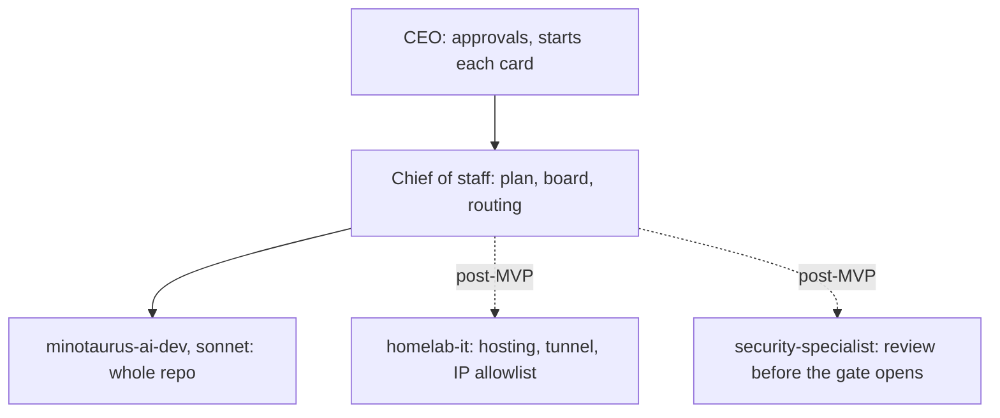

# Team

## Involvement log

| Date | Who | What |
|---|---|---|
| 2026-11-21 | chief of staff | design with EGM (Overview, Technical Plan, Alternatives, Implementation); skeleton; board |
| 2026-11-21 | minotaurus-ai-dev | S1: schemas, easy-01, engine (levels, observe, MazeEnv, Race), `play`, 43 tests |
| 2026-11-21 | minotaurus-ai-dev | web: React + React Aria hello world, `minotaurus dev`, backlog S4 updated (CEO decision) |
| 2026-11-21 | minotaurus-ai-dev | S4: arena page (React Aria), messages contract, mock mode, 10 bun tests |
| 2026-11-21 | minotaurus-ai-dev | web: restyle with design-taste-frontend (achromatic-ledger), RAC component set in `web/src/components/` |
| 2026-11-22 | minotaurus-ai-dev | S2: trainer (Q-table, DQN), ONNX export, safe brain loader, `check-brain`, `play --brain`, 77 tests |
| 2026-11-22 | minotaurus-ai-dev | S3: local arena server (messages, run loop, levels, upload, WebSocket run), training graph, TRAINING.md, backlog G1 to G5, 117 tests |
| 2026-11-22 | minotaurus-ai-dev | W1: confetti on a finish, progress charts (steps per run, outcomes), 33 bun tests |
| 2026-11-22 | minotaurus-ai-dev | web: maze drawn as thin wall lines (`wallLines` in draw.ts), 37 bun tests |
| 2026-11-22 | minotaurus-ai-dev | data: 5 new levels (easy-02, medium-01, medium-02, hard-01, hard-02), levels listed easy to hard, 119 tests |
| 2026-11-23 | minotaurus-ai-dev | G1: maze generator, train / validation / test pools, scores.json, 131 tests |
| 2026-11-23 | Mo (rackiavic) with Claude Code | R1 and G4: DQN research (shaping, step limit, curriculum, best brain on validation, random moves when playing), loader warm-up fix |
| 2026-11-24 | minotaurus-ai-dev | G2: path ratio (metrics, arena result) and parameter count (metrics, .onnx metadata), 302 tests |
| 2026-11-24 | minotaurus-ai-dev | train: end-of-run summary with time taken and the last figures (`trainer/summary.py`), 305 tests |
| 2026-11-24 | minotaurus-ai-dev | G6: several seeds in parallel (`--seeds`, `--parallel`, config `seeds`, `parallel`), best seed by validation, 315 tests |
| 2026-11-24 | minotaurus-ai-dev | G7: mixed maze sizes (`generated.sizes`), hand-made levels as an extra score (`fixed_levels.json`), example `dqn-mixed-brain.json`, 322 tests |
| 2026-11-24 | minotaurus-ai-dev | G8: 12 saved test mazes in the portal, `impossible` difficulty and `impossible-01` (41x41, shortest path 561), mixed-size example 600/120/120, 330 tests |
| 2026-11-24 | minotaurus-ai-dev | G9: progress bar while training (`trainer/progress.py`, one run and several seeds), 341 tests |
