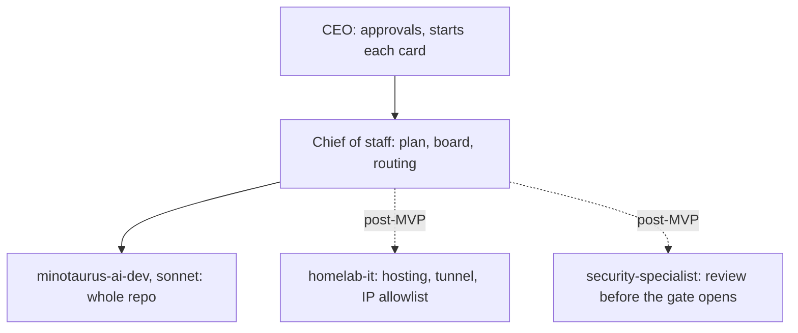

# Team

## Involvement log

| Date | Who | What |
|---|---|---|
| 2026-11-21 | chief of staff | design with EGM (Overview, Technical Plan, Alternatives, Implementation); skeleton; board |
| 2026-11-21 | minotaurus-ai-dev | S1: schemas, easy-01, engine (levels, observe, MazeEnv, Race), `play`, 43 tests |
| 2026-11-21 | minotaurus-ai-dev | web: React + React Aria hello world, `minotaurus dev`, backlog S4 updated (CEO decision) |
| 2026-11-21 | minotaurus-ai-dev | S4: arena page (React Aria), messages contract, mock mode, 10 bun tests |
