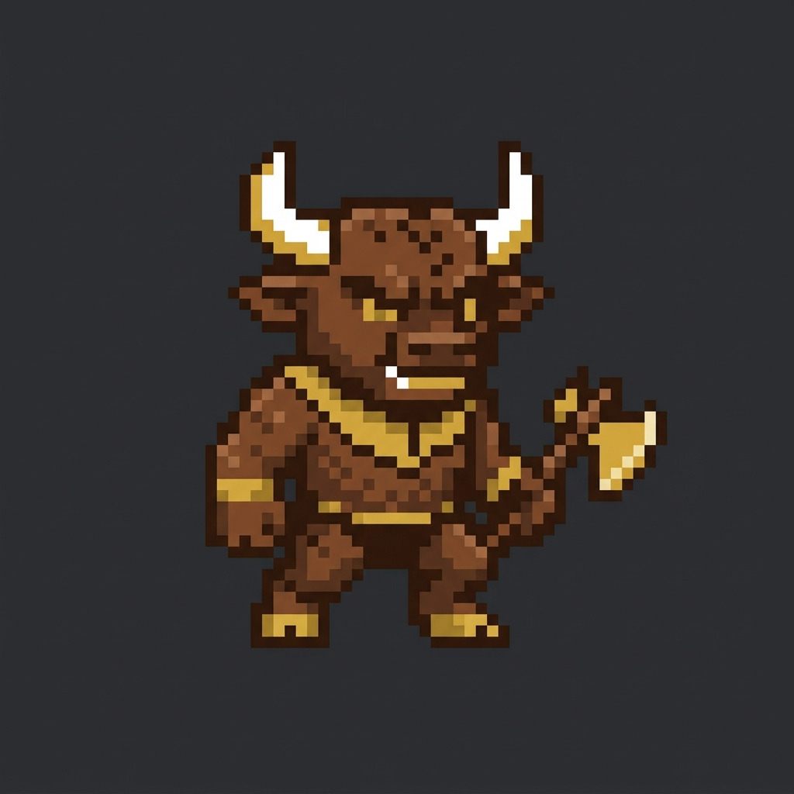

<p align="center">
  
</p>

# minotaurus-ai

Train a "brain" that solves a 2D maze with reinforcement learning (a Q-table or a neural network),
export it as an `.onnx` file, then run it in the arena and see how it scores. Later: race a
friend's brain online.

**Status:** the engine, trainer, local arena server and arena page are built (MVP). Design: `.claude/docs/plans/minotaurus-ai.md`.

## Layout

```
minotaurus/            Python package
  cli/                 the `minotaurus` command: one file per command
  engine/              the only copy of the game rules (levels, observe, MazeEnv, Race)
  trainer/             Q-table and DQN training, metrics, checkpoints, ONNX export
  brain/               safe loading of untrusted .onnx brains
  server/              FastAPI game server: rooms, uploads, race loop, WebSocket
data/
  schemas/             JSON Schemas: level, brain config, messages
  levels/              maze levels (JSON, easy to impossible); test-mazes/ = saved test mazes for the portal
  examples/            example brain configs (added in stage 2)
tests/                 pytest
web/                   TypeScript page (Bun, Vite): lobby, race, result; draws only
runs/                  training output (not committed)
```

## Run the skeleton

```sh
uv sync
uv run minotaurus hello          # CLI
uv run pytest                    # tests
uv run minotaurus serve          # server on http://127.0.0.1:8000/api/hello

cd web && bun install            # once
uv run minotaurus dev            # server and page together; open http://127.0.0.1:5173
uv run minotaurus dev --mock     # page with a fake arena inside Vite (to be removed, the real server exists)
```

## How training works

[TRAINING.md](TRAINING.md) explains the rewards, the training loop and the two methods (Q-table and DQN).

## Brains, bundles and the arena database

Training writes `bundle.tar` next to each `brain.onnx` (several seeds also write `best-bundle.tar`):
the brain plus its manifest, settings (`config.json`), scores, graph and metrics. Load the `.tar` in
the Arena and the page shows how the brain was made (Recipe panel), scores it on every level, and
the Brains page compares brains and shows the exam trend. A plain `.onnx` still loads, without a
recipe. For a run made before bundles existed: `uv run minotaurus pack runs/<name>/<time>/seed-N`.

The server keeps loaded brains and their "run all levels" results in `var/arena.db` (SQLite, git-ignored), so they
survive a restart. The brain id is the sha256 of its `brain.onnx`; the page shows the first 8
characters. "Run all levels" plays the 19 portal levels at full speed and saves the result.

## Work board

`BACKLOG.md` lists what is not started, with how to build it; `minotaurus/BOARD.md` and
`web/BOARD.md` are the kanbans. Cards: `.claude/docs/board/`, one Markdown file per task in `todo/`,
`doing/`, `done/` or `blocked/`.

## Credits

The brain drawing shown while a brain loads (`web/src/components/BrainLoader.tsx`) is the Twemoji
"brain" by Twitter, Inc. and other contributors, licensed CC-BY 4.0 (https://github.com/twitter/twemoji),
taken from SVG Repo.
