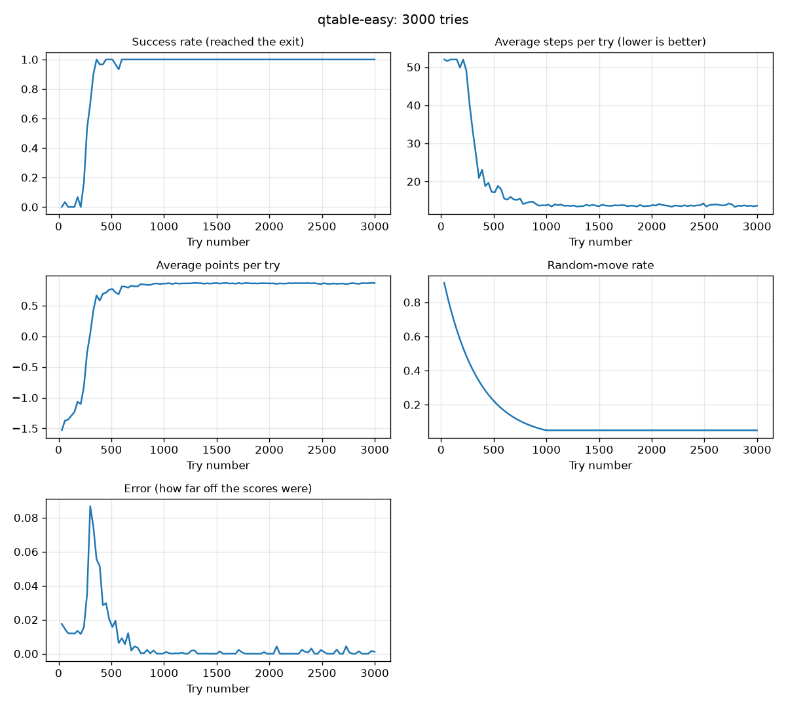
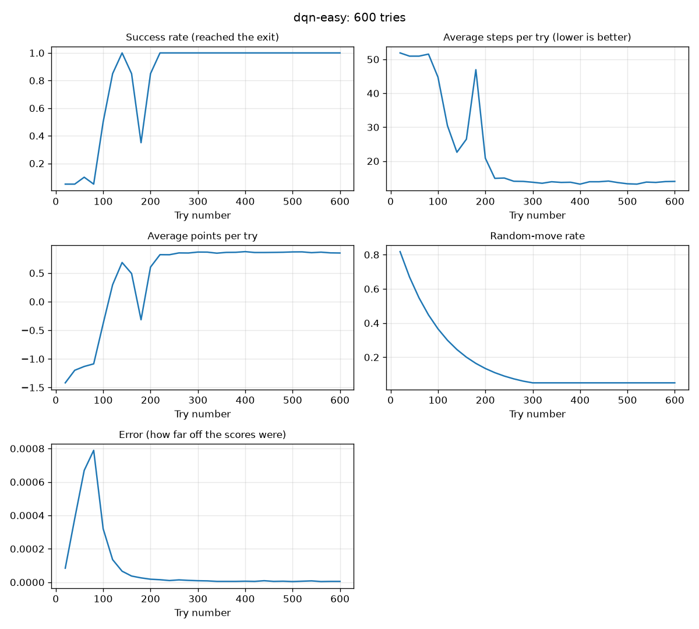

# How training works

A "brain" is a small program that moves a dot through a maze to the exit. You train a brain by
letting the dot play the maze many times and giving it points for good and bad moves. This page
explains the two ways we train. Both give the same kind of file (`.onnx`), so both brains run in the
arena in the same way.

```sh
uv run minotaurus train --config data/examples/qtable-brain.json
uv run minotaurus train --config data/examples/dqn-brain.json
```

## What the brain sees and what it does

- **What it sees:** the dot does not see the whole maze. It sees a square of 5 x 5 cells around
  itself. The game turns that square into a list of **77 numbers**:
  - 25 numbers say which cells are walls (`1` = wall, `0` = free),
  - 25 numbers say which cell is the exit (`1` = exit, `0` = not),
  - 25 numbers say which cells the dot has already walked on (`1` = yes, `0` = no),
  - 2 numbers say which way the exit is (each is `-1`, `0` or `1`).
- **What it does:** it gives back **4 scores**, one for each move: up, down, left, right. The dot
  takes the move with the highest score.

Where 77 comes from: 25 cells x 3 kinds of information = 75, plus 2 for the exit direction = 77.
The code is `obs_size()` in `minotaurus/engine/observe.py`.

## Points

After every move the game gives the dot points. They are game rules, so they are not in the config
file (`minotaurus/engine/env.py`).

| What happens | Points |
|---|---|
| The dot reaches the exit | +1 |
| The dot takes a step | -0.01 |
| The dot hits a wall | -0.05 |

Every step costs a little, so a short way out ends with more points than a long way.

## How a training run goes

One **try** is one walk from the start until the dot reaches the exit or runs out of steps. Training
repeats the try many times. The number is `episodes` in the config. In every try, at every step:

1. **Look:** the game shows the dot what it sees now.
2. **Pick a move:** most of the time the move with the highest score. Sometimes a random move, so
   the dot keeps testing new things. At the start almost every move is random.
3. **Move:** the game makes the move and gives points.
4. **Learn:** the brain changes its scores using those points. The two ways of training differ here.

After many tries, the points from the exit spread backwards along the way to it. The random moves
become less frequent, so the dot uses more of what it has learned. The code is in
`minotaurus/trainer/train.py`.

## Way 1: Q-table (a table of scores)

A **table**. Each row is one thing the dot has seen (the 77 numbers), and next to it are 4 scores,
one for each move:

```
what the dot saw             up     down    left    right
view A  [0,1,0,0,1,...]      0.10   0.00    0.05    0.70
view B  [1,1,0,0,0,...]      0.00   0.30    0.00    0.00
```

The table starts empty. When the dot sees something new, a new row is added with all scores at 0.

**How it learns:** after a move, the score of that move is changed to match two things: the points
it just got, and the best score in the next row. So a move gets a high score when it gives points
now, or when it leads to a place with a high score. That is how the exit's +1 spreads backwards.

**Good:** simple and fast. You can open any row and see the 4 scores, so you can see why the dot
chose a move. On `easy-01` it reaches the exit every time (395 rows, 13 steps, the shortest way).

**Not so good:**
- Two different places in the maze can look the same to the dot, so they share one row.
- A bigger maze gives many more rows, so the table gets huge. It only suits small mazes.
- It knows nothing about something it has never seen.

Code: `minotaurus/trainer/qtable.py`. Settings: the `qtable` block of the config.

## Way 2: DQN (a small neural network)

A neural network is a formula with many numbers that can be adjusted. The 77 numbers go in, some
calculations happen in the middle, and 4 scores come out. There is no table. The network learns
patterns, so it can give good scores even for something it has never seen.

**How it learns:** it uses the same idea as the table (points now plus the best score next), but it
adjusts its formula numbers instead of table rows. Two things make this steadier:
- It remembers the last 20,000 steps and learns from a random handful of them each time, not only
  from the latest moves.
- It checks its answers against a frozen copy of itself, and refreshes that copy only now and then.

**Good:** it handles new places, so it can grow to bigger mazes.
**Not so good:** it is slower, has more settings, and its training can go up and down.

Code: `minotaurus/trainer/dqn.py`. Settings: the `dqn` block of the config.

## The training graph

When training ends, `train` draws `training.png` in the run folder. Switch it off with `--no-plot`.
Each panel shows how one number changes over the tries:

- **Success rate:** how often the dot reached the exit. It should climb to 1.0 (always).
- **Average steps per try:** it should fall towards the shortest way (13 steps on `easy-01`).
- **Average points per try:** it should rise, because short and clean walks score more.
- **Random-move rate:** it falls on purpose, so the dot trusts what it learned more over time.
- **Error:** how far off the brain's scores were. It should shrink and stay small.

Q-table on `easy-01` (3000 tries):



DQN on `easy-01` (600 tries). Notice the dip around try 180: neural network training can go up and
down before it settles.



## Settings and results

- A config file says which way to train, which levels, how many tries and which seed (the number
  that makes a run repeatable). Examples: `data/examples/`.
- The same seed gives the same training run.
- A run makes the folder `runs/<name>/<time>/` with:
  - `metrics.jsonl`: the average points, steps and success rate as training goes,
  - `training.png`: the graph of those numbers,
  - `checkpoints/`: saved copies from during training,
  - `config.json`: the settings used,
  - `brain.onnx`: the finished brain,
  - `scores.json`: only with made mazes (below): how often the brain finishes the practice,
    check and test mazes.
  The `runs/` folder is not committed.
- Check a brain: `uv run minotaurus check-brain <file.onnx>`.
- Watch a brain play: `uv run minotaurus play --brain <file.onnx>`.

## Made mazes: practice, check and test

One hand-made maze is not a fair test: the brain can just learn that one maze by heart. With
`"levels": {"generated": {...}}` (example: `data/examples/qtable-generated.json`) the game makes many mazes
from a number and splits them into three piles:

- **practice (train):** the brain learns on these,
- **check (validation):** mazes it never practised on, to see if it really learned,
- **test:** more unseen mazes, for the final score.

No maze layout is in two piles. The same `maze_seed` always makes the same piles. After training,
`scores.json` shows the share of mazes finished in each pile. A big gap between practice and the
others means the brain learned the mazes by heart. A Q-table does exactly that today (about 90% on
practice and 0% on check and test), which is the reason for this feature.

### Keeping the best brain (on by default with made mazes)

A brain can get worse late in training (a DQN can suddenly forget). With made mazes, training
checks the brain on the check (validation) mazes every 250 tries and at the last try, and keeps
the best one; a tie keeps the later brain. `minotaurus train` prints which try it kept, and
`metrics.jsonl` and the `.onnx` file record it. If no check finished a single maze, the final
brain is kept and a warning is printed. `"eval_every": 100` checks more often; `"eval_every": 0`
switches it off (the last brain is kept, as before).

### Size curriculum (experimental: it did not help)

With made mazes, `"stages": [5, 7, 9]` trains on small mazes first: the tries are split evenly
over the sizes, and the last size must be the maze `size` (the practice pile). The smaller sizes
use up to `train` practice mazes each; 5 x 5 has only 2 different mazes and 7 x 7 only 14.

It did **not** help. In the 2026-11-23 research (DQN, size 9, 3 seeds) two of three brains never
learned the size 9 mazes after the small ones, even with the best saved brain (8% or less on
check mazes); the plain set-up did better. Kept for further tests only.

## DQN on made mazes: what works (research 2026-11-23)

Full write-up with every table: [docs/research/2026-11-23-dqn-shaping.md](docs/research/2026-11-23-dqn-shaping.md).
Ready-made config: `data/examples/dqn-shaped-brain.json`.

- **A plain DQN learns nothing on made mazes:** the exit is too rare to find by chance (0% at
  size 9 and 11).
- **Reward shaping** (`"dqn": {"shaping": true}`): every training step also earns a little for
  getting closer to the exit and loses a little for moving away (measured by walking distance).
  Training only: scoring and the arena use the plain points. Size 9: 0% -> 69% on test (8 seeds).
  `"shaping_on_bump": false` skips it on a bump into a wall (experimental, no gain on check mazes).
- **Longer training tries** (`"train_step_limit_factor": 20`): training tries may last 20 x the
  shortest path instead of 4 x; scoring stays at 4 x. With shaping it made two of three brains
  collapse late, which keeping the best brain (above) repairs. Not needed with shaping alone.
- **Random moves when playing** (`"policy_epsilon": 0.1`): the brain makes 10% of its moves at
  random in the arena and in scoring, from a seeded random source, so a run can be replayed. A
  brain without memory gets stuck in loops; at size 9 this lifts test from 69% to 83%, but routes
  are 1.36 x the shortest. 0 (the default) changes nothing.
- **Size 11 is still hard:** 8% on test (21% with random moves).

Every option a run used is saved in `config.json` and in the `.onnx` file (`training`).

## Not built yet

See `BACKLOG.md`: better numbers to compare brains, and random and shortest-way players to compare
against. Other ways of training are later ideas.
