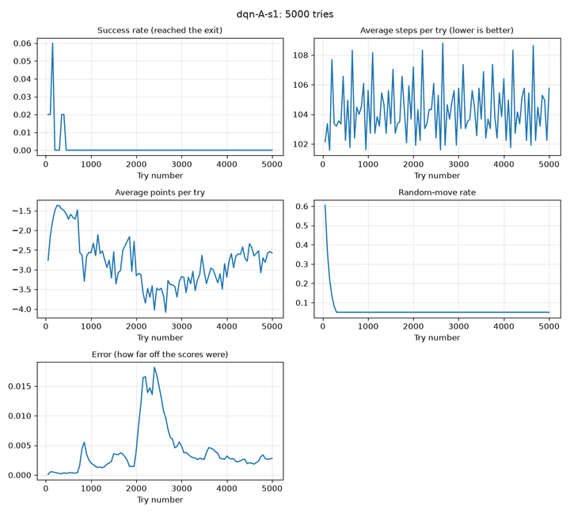
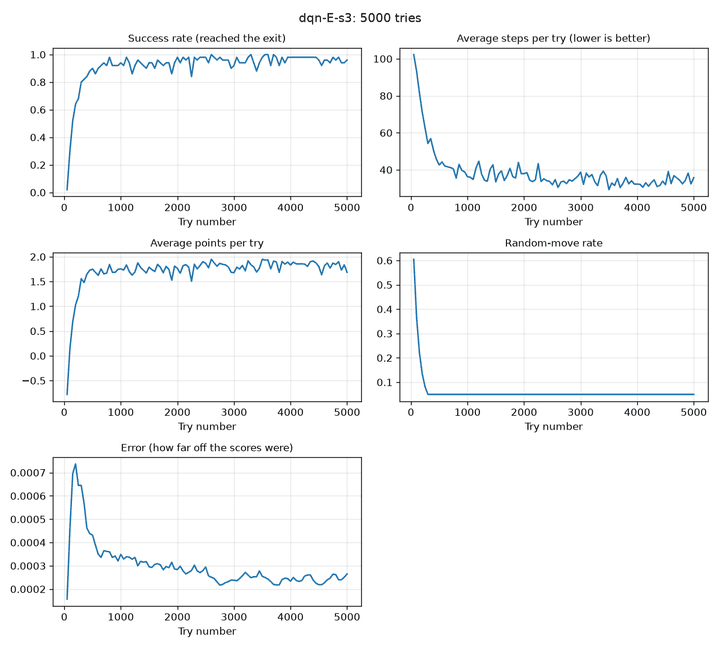
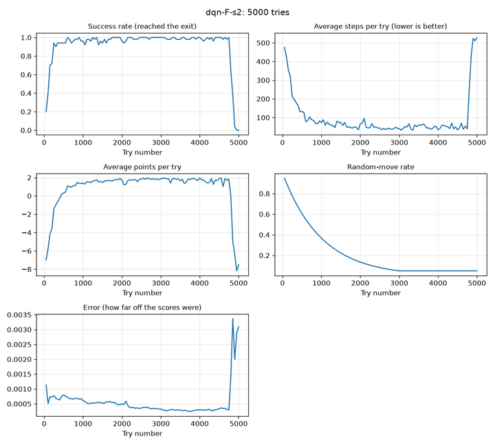

# DQN on generated mazes: reward shaping, step limits, curriculum, best checkpoint, random moves

Research of 2026-11-23, three rounds. Branch work by Mo (rackiavic) with Claude Code. Every
number below comes from a real run; the scripts are in `scripts/research/`.

**Follow-up:** the official brain trained from these results (8 seeds, best on VAL, TEST and arena
scores) is in [2026-11-23-official-brain.md](2026-11-23-official-brain.md).

## Set-up (all rounds)

- **Brain:** DQN with the settings of `data/examples/dqn-brain.json` (MLP 64-64, learning rate
  0.001, batch 64, gamma 0.98, replay 20 000, target update 200, epsilon 1.0 to 0.05, decay 0.99
  per try) unless a row says otherwise. Default rewards: exit +1, step -0.01, bump -0.05.
- **Mazes:** generated pools, `maze_seed` 1, the same for every seed of a run, so seeds differ only
  in training. 5000 tries per run.
- **Scoring:** `trainer/evaluate.py` at the normal step limit (4 x the shortest path), on the
  validation (VAL) and test (TEST) pools. The loader's per-step time limit was raised to 1 s for
  scoring only, because up to 12 runs shared the CPU.
- **Random player:** a seeded player that picks every move at random, on the same TEST mazes.
- **Steps / shortest:** steps divided by the maze's shortest path, on finished mazes.
- **Pools:** A = size 9, 222 train / 50 val / 50 test. B = size 11, 222 / 100 / 100.
  C = size 11, 500 / 100 / 100.

**Size 9 has only 322 different mazes** (the count stays at 322 from 20 000 to 200 000 seeds), so
a 500-maze train pool at size 9 cannot exist. Pools A use every size 9 maze once. Size 5 has 2
different mazes and size 7 has 14.

## Round 1: plain DQN learns nothing (A, B, C)

| Run | Train | VAL | TEST | Random TEST | Mean steps TEST | CPU per run |
|---|---|---|---|---|---|---|
| A: size 9, 222/50/50 | 0% | 0% | 0% | 0% | 103.8 | 1597 +/- 18 s |
| B: size 11, 222/100/100 | 0% | 0% | 0% | 0% | 154.5 | 2280 +/- 4 s |
| C: size 11, 500/100/100 | 0% | 0% | 0% | 0% | 154.5 | 2273 +/- 9 s |

Mean +/- std over 3 seeds; every seed scored 0% everywhere.

- **Not argmax ties:** the four scores were never exactly equal on any VAL or TEST step. (The
  Q-table's 0% has a different cause: an unseen view gives four zeros and argmax picks "up".)
- **Sparse reward:** a random walk reaches the exit within the step limit in 0 of 500 tries at
  size 9 and 0 of 500 at size 11; it needs a median 48 x (size 9) and 73 x (size 11) the shortest
  path. Epsilon reaches 0.05 by try 300, and training success is at most 10% in any 50-try window.
  The brain learns only "do not bump", never where the exit is.

## Round 1b: shaping, longer training episodes, curriculum (D to G, pools A)

- **D:** training step limit 20 x, epsilon decay 0.999.
- **E:** potential-based shaping, r += gamma * phi(s') - phi(s), phi = -(BFS distance to the exit)
  / (largest distance in that maze). Everything else default.
- **F:** D + E.
- **G:** F + size curriculum 5 -> 7 -> 9 (tries split evenly; sizes 5 and 7 use all their mazes).

| Run | Exits in first 500 tries | Train | VAL | TEST | Random TEST | Steps / shortest | CPU per run |
|---|---|---|---|---|---|---|---|
| A (round 1) | 4% | 0% | 0% | 0% | 0% | n/a | 1597 s |
| D | 23% +/- 5% | 0% | 0% | 0% | 0% | n/a | 6098 +/- 30 s |
| **E** | 59% +/- 8% | **81% +/- 1%** | **66% +/- 9%** | **69% +/- 8%** | 0% | 1.00 | **751 +/- 22 s** |
| F | 74% +/- 2% | 27% +/- 46% | 27% +/- 46% | 25% +/- 43% | 0% | 1.00 | 1718 +/- 325 s |
| G | 98% +/- 1% * | 23% +/- 40% | 19% +/- 33% | 21% +/- 36% | 0% | 1.01 | 2247 +/- 1074 s |

\* G's first 500 tries are all 5 x 5 mazes. The first-500 column for D, F and G counts exits within
the 20 x training limit.

VAL / TEST per seed:

| Seed | D | E | F | G |
|---|---|---|---|---|
| 1 | 0 / 0% | 56 / 72% | 80 / 74% | 0 / 0% |
| 2 | 0 / 0% | 70 / 60% | 0 / 0% (collapsed) | 0 / 0% (collapsed) |
| 3 | 0 / 0% | 72 / 74% | 0 / 0% (collapsed) | 58 / 62% |

- **Shaping is what makes it learn:** E reaches 69% on TEST at the normal step limit, in half the
  CPU of the plain run (episodes end sooner).
- **A longer limit alone does not fix sparse reward:** D reaches the exit more often while
  exploring but ends at 0%.
- **20 x episodes with shaping are unstable:** F-s2 and F-s3 held 96 to 100% training success
  until try 4000, then collapsed (loss up 10 to 100 x). Their try-4000 checkpoints score 64 / 60%
  and 54 / 46% (VAL / TEST).

## Round 2: best checkpoint, more seeds, size 11, no shaping on bumps

### Best checkpoint on VAL (F and G, checkpoints every 500 tries)

| Run | VAL per checkpoint (500 ... 5000) | Best | VAL | TEST | Last brain TEST |
|---|---|---|---|---|---|
| F-s1 | 28 44 62 42 58 58 64 60 78 80 | 5000 | 80% | 74% | 74% |
| F-s2 | 52 62 48 34 72 64 44 64 48 0 | 2500 | 72% | 62% | 0% |
| F-s3 | 26 68 76 66 66 72 62 54 52 0 | 1500 | 76% | 64% | 0% |
| G-s1 | 0 0 0 0 4 6 2 0 0 0 | 3000 | 6% | 10% | 0% |
| G-s2 | 0 0 0 6 8 4 0 0 0 0 | 2500 | 8% | 12% | 0% |
| G-s3 | 0 0 0 0 2 2 2 42 50 58 | 5000 | 58% | 62% | 62% |

F with the best checkpoint: TEST 67% +/- 6% (was 25% +/- 43%). G: 28% +/- 29%; the curriculum
hurts, and two seeds never passed 8% on size 9 VAL. (No VAL ties at the best value, so the tie
rule does not change these picks.) This is backlog item G4, now built.

### E with 8 seeds (pools A)

| Seed | 1 | 2 | 3 | 4 | 5 | 6 | 7 | 8 | Mean +/- std |
|---|---|---|---|---|---|---|---|---|---|
| Train | 82% | 79% | 82% | 88% | 85% | 87% | 82% | 79% | 83% +/- 3% |
| VAL | 56% | 70% | 72% | 74% | 76% | 74% | 70% | 66% | 70% +/- 6% |
| TEST | 72% | 60% | 74% | 86% | 62% | 72% | 72% | 54% | **69% +/- 10%** |

No E seed collapsed; training success stayed at 64% or more after try 2000. CPU 738 +/- 18 s.

### E at size 11 (pools B) and E without shaping on bumps ("Enb", pools A)

| Run | Seeds | Train | VAL | TEST | CPU per run |
|---|---|---|---|---|---|
| E, size 11 | 3 | 9% +/- 14% | 6% +/- 9% | 8% +/- 11% | 1092 +/- 194 s |
| Enb, size 9 | 3 | 85% +/- 3% | 75% +/- 6% | 74% +/- 5% | 706 +/- 17 s |

At size 11 the training success (with 5% random moves) was 58 to 72% for two seeds, but the
exported brain (no random moves) solves 1 to 25% of the same train mazes.

## Round 3: random moves when playing, and Enb with 8 seeds

### Test-time random-move rate (eps), 5 seeded repeats per brain, rate and split

E, size 9 (8 brains):

| eps | VAL | TEST | Steps / shortest VAL | Steps / shortest TEST | Failed episodes that loop |
|---|---|---|---|---|---|
| 0 | 70% +/- 6% | 69% +/- 10% | 1.01 | 1.00 | 100% |
| 0.02 | 75% +/- 4% | 74% +/- 9% | 1.14 | 1.12 | 100% |
| 0.05 | 80% +/- 4% | 79% +/- 7% | 1.23 | 1.24 | 100% |
| **0.1** | **83% +/- 4%** | **83% +/- 5%** | 1.34 | 1.36 | 100% |

E, size 11 (3 brains):

| eps | VAL | TEST | Steps / shortest VAL | Steps / shortest TEST | Failed episodes that loop |
|---|---|---|---|---|---|
| 0 | 6% +/- 9% | 8% +/- 11% | 1.00 | 1.00 | 100% |
| 0.02 | 10% +/- 13% | 12% +/- 16% | 1.85 | 1.54 | 100% |
| 0.05 | 14% +/- 16% | 17% +/- 21% | 2.04 | 1.90 | 100% |
| 0.1 | 19% +/- 19% | 21% +/- 24% | 2.13 | 2.01 | 100% |

"Loop" = the same (position, 77-number view) seen 3 or more times in one failed episode. With
eps 0 the five repeats are identical and match the official scores. Every size 9 brain improves on
VAL as eps rises; 0.1 was the highest rate tried and the curve is still rising. Size 11 stays far
below 30% (one brain reaches 47% on TEST at 0.1, one is at 0%).

### Enb against E, 8 seeds each (pools A)

| Run | Train | VAL | TEST | Bumps (TEST) |
|---|---|---|---|---|
| E | 83% +/- 3% | 70% +/- 6% | 69% +/- 10% | 22% +/- 9% |
| Enb | 83% +/- 5% | 68% +/- 7% | 74% +/- 6% | 17% +/- 6% |

Paired by seed, Enb is -1.2 points on VAL (t = -0.29; better on 2 seeds, worse on 5) and +4.5
points on TEST (t = 1.17; better on 7, worse on 1). VAL is the one to choose on, and it shows no
gain.

## Findings

1. **Sparse reward is the blocker.** Plain DQN never sees the exit at size 9 or 11 and scores 0%.
2. **Potential-based shaping fixes it at size 9:** 0% -> 69% +/- 10% on TEST over 8 seeds, stable,
   at half the CPU. Finished mazes are solved by the shortest route.
3. **20 x training episodes make shaped DQN collapse late; G4 rescues it:** the last brains of
   F-s2 and F-s3 score 0%, their best checkpoints on VAL 62% and 64% on TEST.
4. **The size curriculum hurt:** two of three seeds never learned size 9 after sizes 5 and 7.
5. **Enb (no shaping on bumps) gives no gain on VAL** over 8 seeds; TEST is +4.5 points, within
   noise. Kept as an experimental option.
6. **Failures are loops:** every failed episode repeats a (position, view) at least 3 times. A
   memoryless brain that always plays its best move gets stuck; a 10% random-move rate lifts size 9
   to 83% on TEST at the cost of 1.36 x the shortest route.
7. **Size 11 still fails:** 8% on TEST, 21% with eps 0.1.

## Next ideas

- **Visit counts as input (obs_version 2):** the 5 x 5 window shows "visited" but not how often;
  counts would let the brain see a loop. A new input contract, so a new obs_version.
- **PPO** (an on-policy method with a stochastic policy) instead of DQN: random moves become part of
  the brain rather than a patch.
- **Memory:** a recurrent brain (the reserved `memory` setting) to remember where it has been.
- Choose the random-move rate on VAL above 0.1; for size 11, best checkpoint plus random moves, or
  more tries.

## What went into the code

Training options (`TRAINING.md`): `dqn.shaping`, `dqn.shaping_on_bump`, `train_step_limit_factor`,
`stages` (experimental), `eval_every` (best brain on validation, on by default with pools),
`policy_epsilon` (seeded random moves when playing), all recorded in `config.json` and the `.onnx`
metadata. Example: `data/examples/dqn-shaped-brain.json`.
