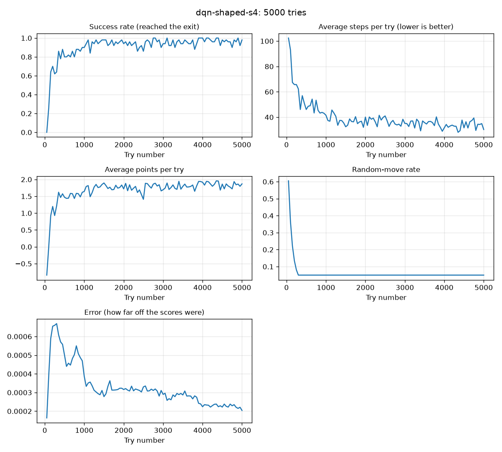

# Official shaped DQN brain v1

Training run of 2026-11-23 that produced the official brain `official-dqn-shaped-v1.onnx`. It
follows the research in [2026-11-23-dqn-shaping.md](2026-11-23-dqn-shaping.md). Every number below
comes from a real run. The scripts are in `scripts/research/` (`official_*`).

## Set-up

- **Config:** `data/examples/dqn-shaped-brain.json`, unchanged except `seed` and `name`: DQN, MLP
  64-64, shaping on, generated size 9 pools (`maze_seed` 1, 222 train / 50 val / 50 test), 5000
  tries, best brain on validation every 250 tries (a tie keeps the later one).
- **Seeds:** 1 to 8, run in parallel with `minotaurus train` (`official_train.sh`).
- **Hardware:** CPU only (no GPU), one torch thread per run. **Wall time: 10 min 21 s** for all 8.
- **Scoring:** `trainer/evaluate.py` and the research `play()` helper at the normal step limit
  (4 x the shortest path).

## Per-seed results on VALIDATION

Each seed's exported brain (its best validation checkpoint), played on the 50 validation mazes.

| Seed | VAL success | VAL mean steps | Steps / shortest (finished) | Kept episode |
|---|---|---|---|---|
| **4** | **92%** | **32.4** | 1.02 | 4250 |
| 2 | 86% | 38.4 | 1.04 | 4250 |
| 5 | 82% | 40.1 | 1.01 | 4000 |
| 3 | 80% | 41.8 | 1.00 | 3750 |
| 6 | 78% | 43.3 | 1.01 | 1750 |
| 7 | 78% | 44.6 | 1.02 | 4500 |
| 1 | 76% | 45.5 | 1.02 | 3000 |
| 8 | 74% | 46.2 | 1.00 | 4000 |

Mean over 8 seeds: 81% on VAL.

## How the winner was chosen

On **VALIDATION only**: highest success, and on a tie fewer mean steps on VAL
(`official_select.py`, which never plays the test mazes). **Seed 4 won** with 92%, 6 points
ahead of seed 2, so the tie rule was not needed. `minotaurus train` prints TEST at the end of every
run, but those numbers played no part in the choice.

## Winner checks (seed 4 only)

| Check | Result |
|---|---|
| `minotaurus check-brain` | OK: `dqn-shaped-s4 (dqn)` |
| TEST, `policy_epsilon` 0 | **84%** |
| TEST, `policy_epsilon` 0.05 | **86%** |

`official_eval.py`. Random moves are seeded per maze, as in `evaluate.py`.



## Arena: hand-made levels

One run per level with the arena run loop (`server/arena.py`), seeded as the server seeds it.
The brain plays its best move (no random moves).

| Level | Size | Result | Steps / step limit |
|---|---|---|---|
| easy-01 | 9 | timed out | 52 / 52 |
| easy-02 | 9 | **finished** | 29 / 116 |
| medium-01 | 11 | timed out | 196 / 196 |
| medium-02 | 13 | timed out | 260 / 260 |

**1 of 4 finished.** The brain does well on generated mazes it has never seen (84% on TEST) but
not on the hand-made levels. All 6 hand-made levels are now measured (below): **1 of 6 finishes
greedy**.

## Diagnosis: measured traces on all 6 hand-made levels

Headless runs with the arena's `player()` and `MazeEnv` at each level's step limit
(`official_trace.py`). Greedy = the brain's best move every step. eps = random moves when playing,
success over 200 seeded tries.

| Level | Shortest path | Greedy | eps 0.05 | eps 0.1 |
|---|---|---|---|---|
| easy-01 | 13 | timeout (44 bumps in a row at (3,7)) | 2.5% | 7% |
| easy-02 | 29 | **finished, 29 steps** | 99% | 95% |
| medium-01 | 49 | timeout (190 bumps in a row at (5,3)) | 15% | 46% |
| medium-02 | 65 | timeout (254 bumps in a row at (5,3)) | 88% | 94% |
| hard-01 | 105 | timeout (374 bumps in a row at (9,9)) | 0% | 1% |
| hard-02 | 157 | timeout (585 bumps in a row at (15,16)) | 0.5% | 1.5% |

Random-move success rates come from 200 seeded tries; expect about +/- 3-4 points of sampling noise
(with 50 tries, two seedings differed by up to 20 points on medium-01).

**Main failure: the brain pushes into a wall forever.** A bump does not move the dot, so the view
does not change, and a brain without memory picks the same move again. In every greedy failure,
all of its bumps come in one unbroken run at one square, up to the step limit.

**Blocking moves into visible walls** at play time (no retraining: the move with the best score
that does not walk into a wall next to the dot) solves medium-02 at the shortest path (65 steps)
and keeps easy-02 at 29. It does not fix the rest: easy-01 then goes back and forth between (3,6)
and (3,7) until the step limit, and medium-01, hard-01 and hard-02 fall into the same two-square
loop. Without memory, the brain cannot see that it has been there before.

## Next steps

- **Visit counts as input (obs_version 2):** show how often a square was visited, so the brain can
  see both traps (the wall push and the two-square loop) and leave them. Experiment in progress.
- Then repeat these traces and the arena check, greedy and with random moves when playing.

## Reproduce

```sh
scripts/research/official_train.sh                      # 8 seeds, writes runs/official-dqn-shaped/
uv run python scripts/research/official_select.py       # VAL table and winner
uv run python scripts/research/official_eval.py runs/official-dqn-shaped/s4/<name>/<time>
uv run python scripts/research/official_trace.py brains/official-dqn-shaped-v1.onnx  # traces
```

The same seed gives the same run. The brain file is not committed (`*.onnx` is git-ignored).
It is attached to the GitHub release `brain-dqn-shaped-v1`.
